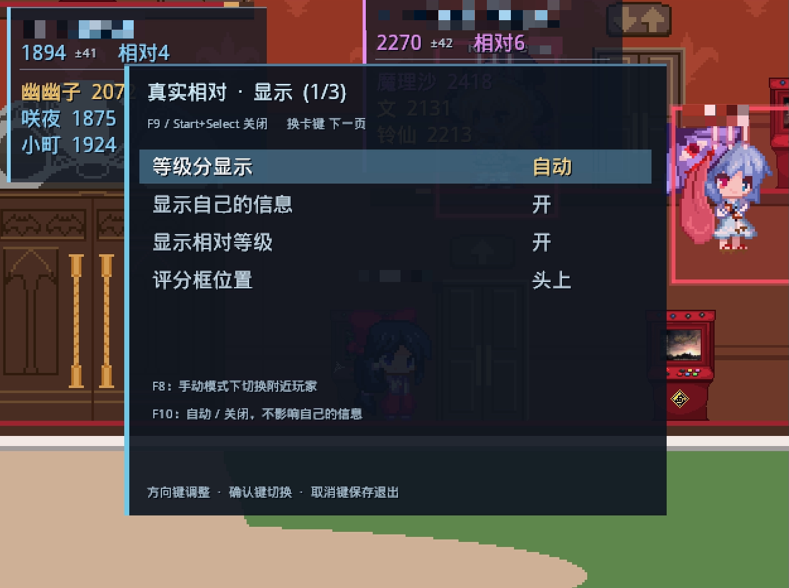
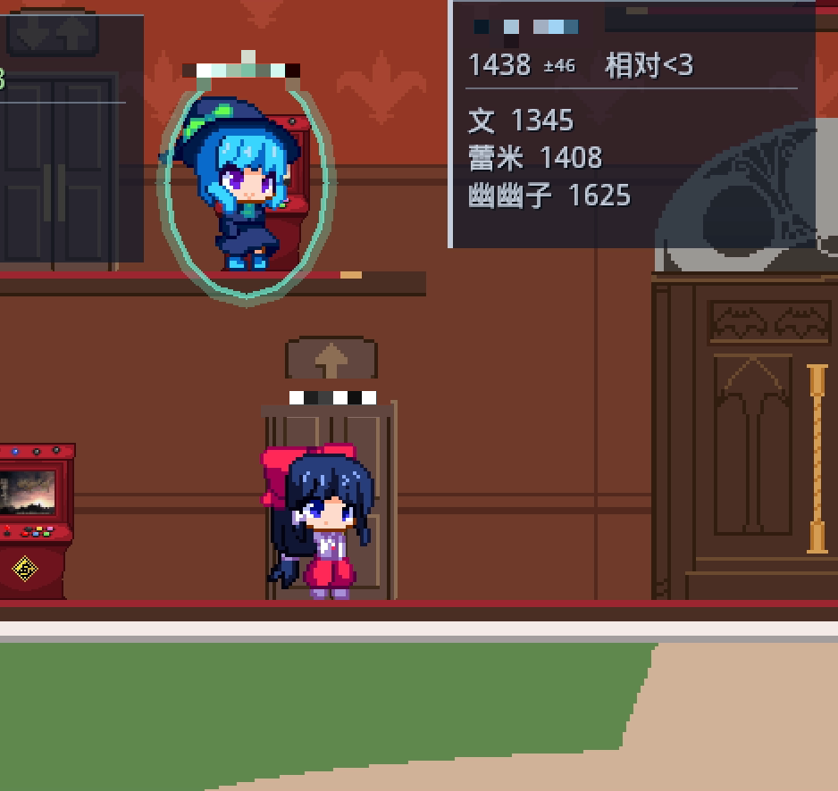

# 真实相对（TrueRelative）

在东方非想天则（Touhou 12.3）联机大厅显示玩家评分和相对等级。

评分数据来自 [soku.cleista.cc](https://soku.cleista.cc/)。

## 截图

## 安装

可通过 SokuLauncher 的“设置 - 插件 - 安装”安装，也可以将安装包解压到游戏的 `modules` 目录。安装后在插件设置里启用“真实相对”。

## 快捷键

| 按键 | 0.7.9 及之前 | 0.8.0 之后 |
| --- | --- | --- |
| F7 | 显示／隐藏相对等级 | 改在 F9 菜单中设置 |
| F8 | 用 F10 关闭自动切换后，手动切换附近玩家 | 在菜单选“手动(F8)”后切换附近玩家 |
| F9 | 显示／隐藏自己的评分框 | 打开设置菜单 |
| F10 | 切换自动显示附近玩家及自己的评分框 | 切换等级分自动显示／关闭 |

手柄 Start+Select 也可打开菜单。方向键调整，换卡键翻页，取消键保存退出。
